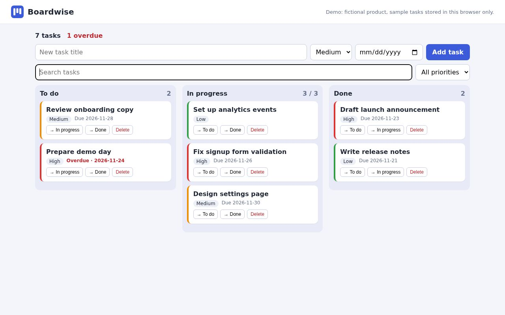
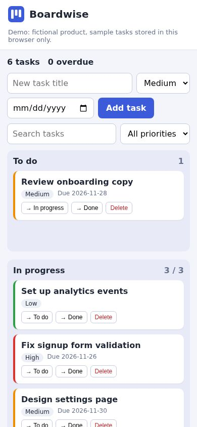

# Boardwise Kanban Board (React + Vite)

A task board demo for a fictional product. Sample tasks only, stored in this browser (localStorage). No server and no accounts.

## Features
- Three columns: To do, In progress, Done
- Drag and drop between columns, or use the move buttons
- Work-in-progress limit: at most 3 tasks In progress, with a clear message when blocked
- Overdue logic: tasks past their due date show as overdue until they are Done, and the overdue counter follows
- Add tasks with title, priority and due date (validated), delete tasks
- Search and priority filter; state persists after reload

## Structure
`src/logic.js` holds the pure rules (move, WIP limit, overdue). `src/components/` has Header, Stats, AddTaskForm, Filters, Column and TaskCard. `src/App.jsx` owns the state.

## Run
```bash
npm install
npm run dev
npm run build
```

## Demo video
[docs/demo.mp4](docs/demo.mp4)

## Preview



## Tests
Headless Chrome checks (22): seed counts, overdue counting and clearing, WIP limit block and release, drag and drop, validation, add and delete, search and priority filters, persistence after reload, mobile overflow, console errors.
